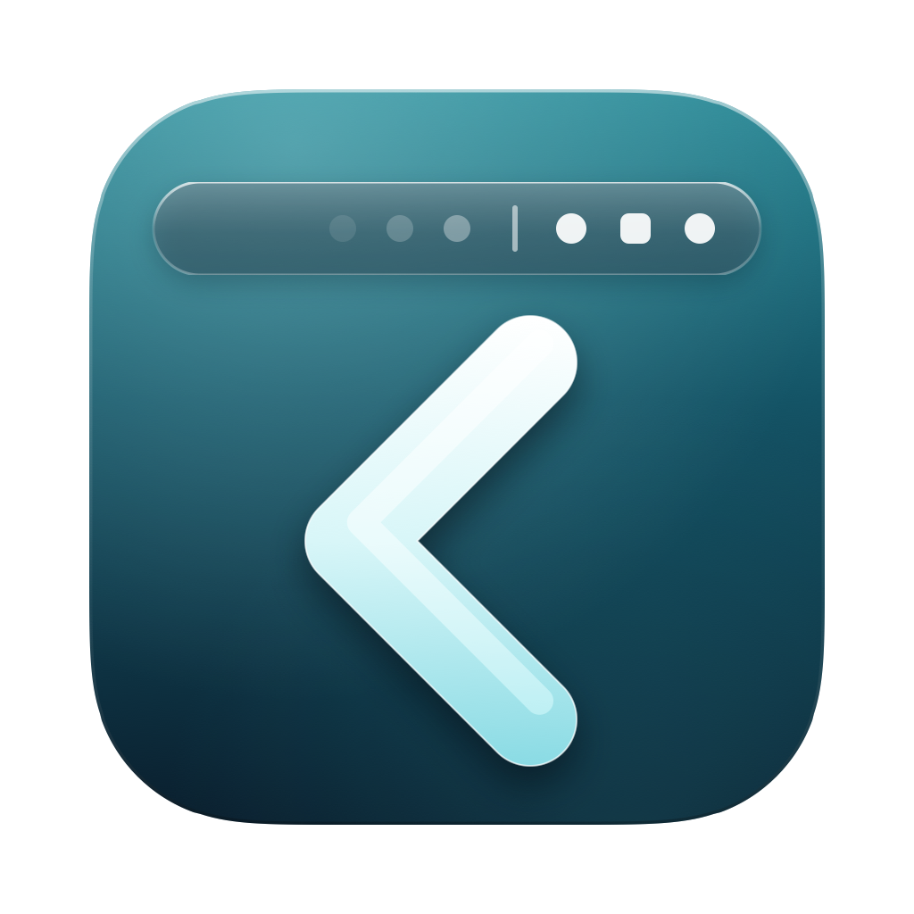
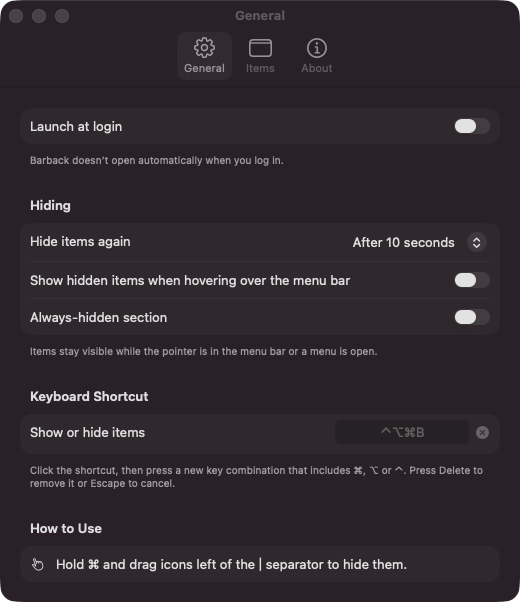
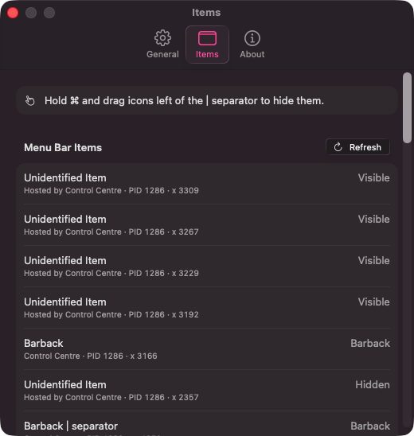
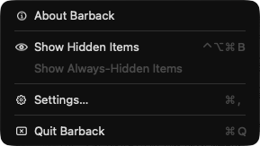

<p align="center"></p>

# Barback

**A fast, lightweight, open-source menu bar item hider for macOS.** Tuck the menu bar icons you rarely use behind a chevron, and bring them back with one click or a hotkey. Barback is a minimal alternative to Bartender: it does one job, instantly, without asking for Screen Recording permission (and Accessibility is only ever optional).

Barback is an independent project, released under the MIT license. It is not affiliated with or endorsed by the makers of Bartender.

**[Website](https://mrashrhodes.github.io/barback/)** · **[Releases](https://github.com/MrAshRhodes/barback/releases/latest)** · **[Changelog](CHANGELOG.md)** · **[Contributing](CONTRIBUTING.md)**

<p align="center">
  
  
</p>
<p align="center">
  
</p>

## Why Barback

- **Fast.** Showing and hiding is a single layout change of Barback's own status items: no screen capturing, no animation polling, no background loops. It's instant, and idle CPU stays at ~0%.
- **No special permissions.** Hiding, showing, the hotkey and hover never need Screen Recording or Accessibility access. The global hotkey uses the Carbon hotkey API, and the item list reads window metadata only. Accessibility is optional and used for two things: showing app names in the Settings › Items list on macOS 26, and, if you choose the drop-down panel, opening a hidden item from it (see below).
- **No network, no telemetry.** Barback makes no network connections and collects nothing.
- **Small and auditable.** One SwiftPM package, no third-party dependencies, MIT-licensed.
- **Feels native.** Built to the macOS Human Interface Guidelines (see [Design](#design)).

## Install

```sh
brew install --cask mrashrhodes/tap/barback
```

Requires macOS 14 Sonoma or later (Apple silicon or Intel).

Or download `Barback-<version>.zip` and `Barback-<version>.zip.sha256` from [Releases](https://github.com/MrAshRhodes/barback/releases) into the same folder and verify the download first:

```sh
cd ~/Downloads
shasum -a 256 -c "Barback-<version>.zip.sha256"   # must print "Barback-<version>.zip: OK"
```

Then extract the zip and move `Barback.app` to `/Applications`. The new release pipeline requires Developer ID signing and Apple notarization, with a stapled ticket for offline verification. Versions through **0.2.1** were ad-hoc signed; they do not gain notarization retroactively. Check the release notes for the version you download. Do not remove quarantine or disable Gatekeeper to work around a rejected download.

Prefer a disk image? Download the `.dmg` and `.dmg.sha256` pair instead, verify it with `shasum -a 256 -c "Barback-<version>.dmg.sha256"`, then open the image and drag `Barback.app` to Applications. The DMG is separately signed, notarized and stapled.

**First upgrade from an ad-hoc build:** quit Barback and replace the app. If you use Accessibility for item identification or the drop-down panel, remove the old Barback entry in **System Settings → Privacy & Security → Accessibility**, add `/Applications/Barback.app` again and enable it, then reopen Barback. The signing identity changes once during this migration; future releases keep the same bundle identifier and Developer ID team.

To update: `brew update && brew upgrade --cask barback`.

## Usage

Barback adds a **chevron** to your menu bar and a thin **separator** to its left.

1. **Choose what to hide.** Hold **⌘ Command** and drag any menu bar item to the **left of the separator**. macOS remembers the positions.
2. **Show or hide.** Click the chevron, or press **⌃⌥⌘B** from anywhere. Items left of the separator slide out of view or back in.
3. **Always-hidden items.** Enable the second (always-hidden) separator in Settings and ⌘-drag items to its left. **Option-click** the chevron to reveal them too.
4. **Menu.** Right-click the chevron for Show/Hide, Show Always-Hidden, Settings… (⌘,), About, Getting Started and Quit.
5. **Make it yours.** In Settings › Appearance, pick a style or choose the icon (chevron, eye, wine glass, mug, Carlos’ Marañon and more), its weight, separator styles (line, dashed, dot, double line, chevron or invisible) and up to three extra dividers for grouping items.
6. **Optional drop-down panels.** In Settings › Panel, click **Add Panel**, give it a name, and choose its items. This sets **Click Barback to** *Open my panels*. Clicking the chevron (or pressing the hotkey) then opens your panels under the icon. See below.

The first time Barback starts, a short tip under the chevron explains the basics; open it again with **Getting Started** in the menu.

Hidden items re-hide automatically after 10 seconds (configurable, or never), but not while the pointer is over the menu bar or a menu is open. Optionally, Barback can also reveal hidden items when the pointer rests on the right-hand (status) side of the menu bar; items revealed this way hide again 0.4 seconds after the pointer leaves the menu bar. You can also have them hide as soon as you switch to another app.

**Settings**

- **General**: launch at login, auto-rehide delay, show on hover, hide when switching apps, always-hidden section, global hotkey.
- **Appearance**: a live preview plus styles (Classic, Minimal, Cocktail, Eye, Arrows), the toggle icon and its weight, an optional accent tint while hidden items are showing, separator styles for each section, and extra dividers. These change only Barback's own items. An invisible separator still leaves a narrow gap you can ⌘-drag.
- **Items**: a read-only list of every menu bar item, the process that owns its window, its section and whether it is currently on screen. It is scanned only when you open the tab or click Refresh (⌘R), off the main thread. On a Mac with a notch, items that would sit behind the notch are flagged so you can hide something else to make room. On macOS 26 Tahoe, Control Center hosts most items' windows, so their source app can't be read from window metadata and they're listed as *Unidentified Item*; if you choose to allow Accessibility access, Barback matches them to app names.
- **Panel**: what clicking Barback does (show the items in the menu bar, the default, or open your panels), and a complete editor for up to 12 panels: select their items, rename, choose an icon and list/grid layout, and reorder panels or their items.
- **About**: version, license and links.

> **Tip:** if the separator ends up to the right of the chevron, Barback won't expand it (that would hide the chevron too) and shows a hint. ⌘-drag the separator back to the left of the chevron.

### Drop-down panel (optional)

With **Click Barback to** set to *Open my panels* (Settings › Panel; the default is still to show the items in the menu bar), a normal left-click on Barback opens your panels directly beneath it, like the ones in Control Center. The same click works even when menu bar items are already revealed. The global hotkey follows the click action; Option-click still reveals everything in the menu bar, including always-hidden items.

- **Configure first.** Click **Add Panel** in Settings › Panel, enter a name, select a symbol and layout, then use **Add Items** to choose what it contains. Use the arrows to order panels and their items. Both list and grid layouts show item names. The gear and panel edit buttons take you back to Settings.
- **Only your selections.** There is no automatic *Other* box. Identifiable items from any section can be selected; always-hidden items are available when that section is enabled. Each item belongs to one panel. Removing a panel or selection does not move or hide its original menu bar icon. Existing saved groups are kept as panels.
- **Honest identification.** Unidentified or ambiguous items are not offered as interchangeable generic icons. On macOS 26, allow Accessibility to identify items hosted by Control Center, then refresh. Saved selections that are not running or cannot be identified remain saved and are marked unavailable, rather than being reassigned to another icon.
- **Open an item.** Accessibility permission is required to press an item's menu. Until it is allowed, item buttons are disabled and the panel provides an explicit **Show in Menu Bar** fallback. With permission, Barback reveals the selected item's section only when needed and opens its menu. Failures are reported instead of silently doing nothing; uncertain presses are not automatically repeated.
- **Look and behavior.** The panel is a borderless window whose right edge lines up with the Barback icon, a few points below it, kept inside the screen. On macOS 26 Tahoe it is made of Liquid Glass; on macOS 14 and 15 it uses a system material instead. It closes when you click elsewhere, press Esc, click the icon again, switch Space or app, or the screen layout changes. Reduce Transparency gives it a solid background, Increase Contrast adds an outline and Reduce Motion drops the slide. The items are reachable with the keyboard and VoiceOver.

### Automation

Barback handles `barback://` URLs, so Shortcuts (*Open URLs*), scripts, Raycast, Alfred or a Stream Deck can drive it. Use `open -g` so the current app keeps focus:

```sh
open -g barback://toggle      # show or hide hidden items
open -g barback://show        # show hidden items
open -g barback://hide        # hide them again
open -g barback://show-all    # also show always-hidden items
open -g barback://toggle-all  # like Option-clicking the chevron
open barback://settings       # open Settings
```

URLs can only show, hide or open Settings; they can't change settings. With VoiceOver on, the hotkey and URL commands announce the result.

## How it works

Barback uses the same well-known technique as Hidden Bar, Dozer and Ice: it owns ordinary `NSStatusItem`s. To hide, it sets the separator's length to a very large value, which pushes every item to its left off the edge of the screen; to show, it collapses the separator back to its normal width. Positions persist through `autosaveName`, so macOS keeps your arrangement across launches. Nothing is captured, moved by synthetic events or polled.

## Design

Barback follows the macOS Human Interface Guidelines:

- **Status items** use SF Symbols as template images, so they adapt to light and dark menu bars, accent tinting and Increase Contrast.
- **Settings** (**⌘,**) is a single window with standard toolbar tabs (General, Appearance, Items, Panel, About), each a SwiftUI grouped form (`.formStyle(.grouped)`), like System Settings-era apps.
- **Accessibility**: status items and controls carry VoiceOver labels; only system colors, fonts and controls are used, so light/dark appearance, Increase Contrast and Reduce Transparency are honored automatically (separators become fully opaque with Increase Contrast). Showing and hiding is instant, with no motion to reduce, and the getting-started popover doesn't animate when Reduce Motion is on. Every toggle icon changes shape with its state, so the optional accent tint is never the only cue. The optional drop-down panel is a labeled dialog that Esc closes, with every item and button reachable by keyboard and VoiceOver.
- **Liquid Glass**: on macOS 26 Tahoe, Barback's menus, toolbar and controls pick up the system's Liquid Glass design because they are standard AppKit/SwiftUI components built against the current SDK, and Settings' buttons explicitly use the `.glass` / `.glassProminent` button styles (behind `#available(macOS 26, *)`, falling back to `.bordered` / `.borderedProminent` on macOS 14 and 15). Menu items get leading SF Symbols on macOS 26 only, as that release's HIG recommends. The drop-down panel is an `NSGlassEffectView` with rounded corners holding SwiftUI `glassEffect` tiles in a `GlassEffectContainer` (also behind `#available(macOS 26, *)`, falling back to an `NSVisualEffectView` popover material with `.thinMaterial` tiles on macOS 14 and 15).
- **App icon** follows the macOS 26 icon grid (824 × 824 continuous-corner body on a 1024 × 1024 canvas) with soft, layered lighting and a single motif, rendered at every size from 16 to 1024 px.

## Barback vs Bartender 6

Barback was inspired by studying how Bartender behaves. It is deliberately much smaller in scope. A neutral summary, as of Bartender 6:

| | Barback | Bartender 6 |
| --- | --- | --- |
| Price / license | Free, open source (MIT) | Paid, proprietary (free trial) |
| Hide/show menu bar items | ✅ chevron, hotkey, optional hover | ✅ plus many more triggers |
| Always-hidden section | ✅ | ✅ |
| Auto-rehide | ✅ | ✅ |
| Rearrange items without ⌘-drag | ❌ (use ⌘-drag) | ✅ |
| Custom icon, separator styles and dividers | ✅ (Barback's own items) | ✅ |
| Automation | ✅ `barback://` URL scheme | ✅ AppleScript, URL scheme, Shortcuts |
| Item groups | ✅ named groups in an optional drop-down panel | ✅ |
| Triggers, presets/profiles, quick search, menu bar styling | ❌ | ✅ |
| Screen Recording permission | Not needed | Requested for its item images and layout features |
| Accessibility permission | Optional (app names in the Items list, opening items from the drop-down panel) | Requested to move and click items |
| How hiding works | Expands its own separator status item | The same separator technique, plus automatic rearranging of other apps' items |
| Background activity when idle | None (event-driven) | Varies with enabled features |
| Minimum macOS | 14 Sonoma | See vendor's site |

If you rely on Bartender's advanced features, keep using it; if you only want a fast, permission-free hider, Barback is for you.

### How it compares to Bartender: what we learned

Before writing Barback we studied Bartender 6 (6.6.2 on macOS 26) from the outside: its public documentation and release notes, open-source peers (Hidden Bar, Ice, Dozer), and a static look at the installed app's bundle, linked frameworks and imported APIs. In summary:

- **Hiding itself is cheap.** Bartender hides items the same way Hidden Bar, Ice and Barback do: by widening one of its own separator status items. That needs no permission and no background work, so Barback copies it.
- **The heavy parts are the extras.** Automatic rearranging works by posting synthetic ⌘-drag mouse events while briefly intercepting the user's clicks; the Bartender Bar, search and item identification on Tahoe rely on capturing images of menu bar items (Screen Recording); app names come from Accessibility queries to every menu-bar app; and optional menu bar styling redraws on a timer. Bartender's own support pages and release notes acknowledge mouse movement, CPU and WindowServer load from these paths, and many releases tune them.
- **What Barback does differently.** It's event-driven: the only timers are one-shot (auto-rehide, hover dwell and the 0.4 s hover exit delay, the same delay Bartender uses), with no polling loops, screen capture, event taps, synthetic events, private APIs, helper processes or network access. You arrange items yourself with ⌘-drag, which macOS remembers.
- **What Barback leaves out** on purpose: automatic arranging, the secondary bar, search, triggers, presets, spacing changes, menu bar styling (Barback only restyles its own icons) and widgets. These all need the permissions and machinery above.
- **macOS 26 caveat.** On Tahoe, Control Center owns the windows of most menu bar items, so any tool reading window metadata sees "Control Center" rather than the real app. Bartender works around this with image hashing and an Accessibility helper; Barback labels such items honestly and only uses Accessibility if you opt in.

## Build from source

Requires Swift 5.9+ (full Xcode or just the Command Line Tools).

```sh
make app        # build and ad-hoc sign dist/Barback.app
make run        # build, then open it
make test       # run the test suite
make zip        # universal build -> dist/Barback-<version>.zip (+ .sha256, dist/barback.rb)
make tap        # render the Homebrew cask to dist/barback.rb from the local zip
make help       # every target
```

See [CONTRIBUTING.md](CONTRIBUTING.md) for the project layout, Command Line Tools notes and the release process.

## Credits

Barback stands on the shoulders of earlier open-source menu bar managers that pioneered the separator technique: [Hidden Bar](https://github.com/dwarvesf/hidden), [Ice](https://github.com/jordanbaird/Ice) and [Dozer](https://github.com/Mortennn/Dozer). Thank you to their authors. Bartender is a trademark of its respective owner.

## License

MIT © 2026 Ashley Rhodes. See [LICENSE](LICENSE).
